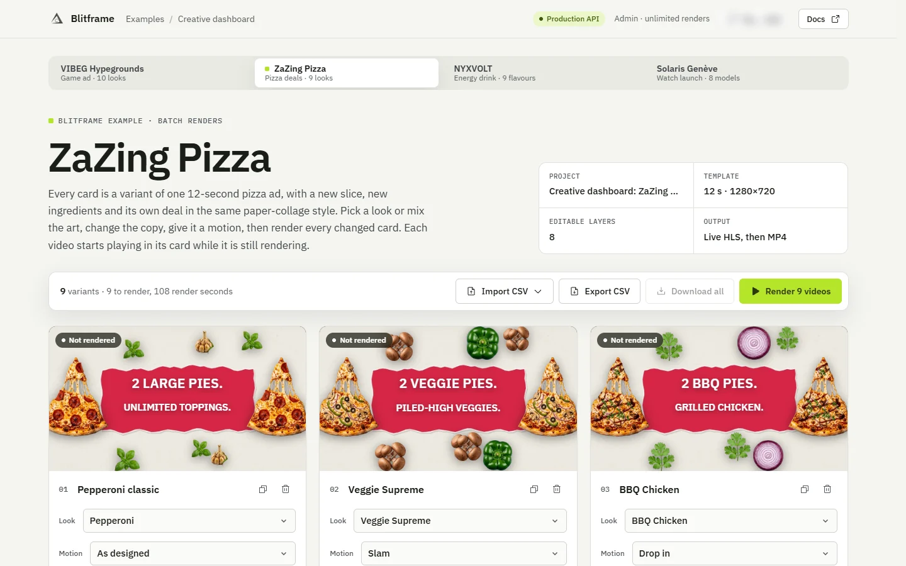

# Creative dashboard with Blitframe


Four ad campaigns, each a template with a library of art, and one dashboard to make variants of them on the [Blitframe API](https://codeartworks.com/docs/blitframe). Every card is a variant: pick its look, mix its art, change its copy, give it a motion style, or load a whole campaign from a CSV. Press **Render** and every changed card renders in one go. Each video starts playing in its card while it is still rendering, the page times the whole run, and when it is done you download every video as one ZIP.

| Campaign | Template | Variants |
|---|---|---|
| **VIBEG Hypegrounds** | A 15-second mobile-game ad | 10 looks in the original's style and layout: a supply drop, a squad, a juggernaut, a new map, a golden rifle and more, with tall cards where the art is vertical |
| **ZaZing Pizza** | A 12-second paper-collage food ad | 9 pies, each with its own slice, toppings, deal and price |
| **NYXVOLT** | A 12.5-second energy drink ad | 9 flavours, each with its own can, opening object and copy |
| **Solaris Genève** | A 12-second watch launch | 8 models, each with its own dial, case, strap and opening photo |

Every campaign also has five motion styles: **Slam**, **Drop in**, **Spin**, **Slide** and **Swing**. They change how the ad's art and copy enter, not its colours.



## What it shows

- Pushing a template folder (`data.json`, its images, a library of alternatives and [text fitting](https://codeartworks.com/docs/blitframe/text-fitting) rules) to a project, and reusing it on every start.
- Finding layers by name with [`GET /v1/versions/{id}/layers`](https://codeartworks.com/docs/blitframe/editing#editable-layers).
- A [batch render](https://codeartworks.com/docs/blitframe/editing#many-videos-from-a-data-sheet), where each card's [replacements](https://codeartworks.com/docs/blitframe/editing#replacements) change text, keep line breaks, and swap images for other files in the same version (`path`, fitted with `contain` or `cover`). No uploads are needed.
- Following every render with one status call, playing each over [live HLS](https://codeartworks.com/docs/blitframe/renders#live-hls) while it renders, stopping a batch, and packing the videos into one [ZIP](https://codeartworks.com/docs/blitframe/renders#download-many-videos-as-one-zip).
- Rendering only the cards that changed since their last video, and showing the exact batch request before it is sent.
- Motion styles you switch per card. Each is a [variation](https://codeartworks.com/docs/blitframe/variations) of the project whose `data.json` animates the entrance of chosen layers, so the cards go out as one batch per motion.
- A field that fills a second, taller layer when its art is vertical, so a tall card keeps a good size in the same spot.
- Loading a campaign from a CSV, with example CSVs for every campaign.
- Connecting with your own API key from the page, kept by the app's server and never by the page.

## Run it

You need [Node.js](https://nodejs.org) 22.18 or later and a Blitframe API key. The free trial is enough: every video is 1280×720 and 15 seconds or shorter.

1. Install the dependencies:

   ```bash
   npm install
   ```

2. Start the dashboard and open [http://127.0.0.1:4173](http://127.0.0.1:4173):

   ```bash
   npm start
   ```

3. Paste your API key when the dashboard asks for it. You create one in **Console → API keys** at
   [app.codeartworks.com/blitframe/api-keys](https://app.codeartworks.com/blitframe/api-keys). The dashboard's own server checks the key
   with Blitframe and saves it to `.env`, which git ignores, so the next start connects by itself. You can also put it in `.env`
   yourself, as `.env.example` shows, and **Key** in the header changes it later.

The first time you open a campaign, its template is pushed to your workspace, which takes a few seconds. Then change a card, add or remove cards, or load an example CSV from **Import CSV**, and press **Render**.

## How it works

| File | Does |
|---|---|
| [`server/dashboard-api.mjs`](server/dashboard-api.mjs) | The dashboard's server side, run inside Vite. It keeps the API key, pushes a campaign's template on its first request, and answers the page: the campaigns, the batch, statuses, stop, the ZIP and CSV import. It also serves the campaigns' images and example CSVs. |
| [`server/motion.mjs`](server/motion.mjs) | Builds a motion's `data.json`: each named layer is hung from a new null layer, between it and its parent, that plays the entrance around the layer's centre. Nothing else moves, so the layer ids replacements use are the same in every motion. |
| [`server/campaign.mjs`](server/campaign.mjs) | The rules every campaign shares: the files a field may use, a campaign's starting cards, the checks every card passes before anything is queued, how a card becomes a render, and how a CSV becomes cards. A card can only choose files its template carries. |
| [`server/blitframe.mjs`](server/blitframe.mjs) | A small client for just these Blitframe calls. |
| [`src/App.jsx`](src/App.jsx) | The page: the campaign tabs, the cards and their previews, the batch toolbar, the request panel and the player. |
| [`src/table.js`](src/table.js) | Small helpers for the cards: which ones changed, their status, their look and the CSV export. |
| [`campaigns/`](campaigns) | One folder per campaign. |

One batch, step by step:

1. **Template.** The first request for a campaign finds its project, or creates it, and sends the campaign's `template/` folder as an edit. Sending the same files again makes no new version.
2. **Motions.** For each motion style the server makes a variation, such as `motion-slam`, that starts at the template's version, and edits it with that motion's `data.json`. It uses `restoreFromVersionId`, so the variation always matches the template apart from its motion.
3. **Layers.** The templates' editable layers have plain names, such as `Pizza` and `Price`. The server looks up the ids replacements need by those names.
4. **Batches.** **Render** sends every card that changed since its last video to `POST /v1/projects/{id}/renders/batch` with `format: "hls"`, one batch per motion, each pinned to that motion's version. A field that keeps the template's value sends no replacement; changed text sends `{ "layer": …, "text": "2 VEGGIE PIES." }`, and changed art sends `{ "layer": …, "path": "images/library/pizza/veggie-supreme.png", "fit": "contain" }`. Each batch is all or nothing, and the page shows the requests it sends.
5. **Live playback.** The page asks `POST /v1/renders/statuses` about the whole batch every 1.5 seconds. Once a render's stream starts, its card fades from its preview into the video.
6. **Results.** A finished card opens a larger player and links its MP4. **Download all** asks for a `POST /v1/renders/download-archive` and opens its link when it is ready.

## A campaign folder

```text
campaigns/pizza/
  campaign.json          the fields, the looks, the motions, the starting cards and the card preview
  preview.jpg            the backdrop of the card's mock
  template/              an ordinary Blitframe project folder, pushed as it is
    data.json
    text_fitting.json
    images/pizza.png
    images/library/pizza/veggie-supreme.png, bbq-chicken.png, …
  examples/              CSVs that Import CSV offers
    pizza.csv
```

`campaign.json` says what the dashboard may change:

| Key | What it is |
|---|---|
| `name`, `tagline`, `description`, `order` | How the campaign shows in the tabs and the header. |
| `project` | The Blitframe project the template is pushed to. |
| `columns` | The editable fields. A `text` field names its `layer` and `maxLength`, and can be `multiline`. An `image` field names its `layer`, its `original` file and a `library` folder of alternatives, and can say how a file is fitted (`contain` or `cover`). Its optional `tall` names a second layer and library for vertical art: a file from there fills that layer, as VIBEG's tall offer cards do. |
| `looks` | Optional. A look is the files that share a name across the image fields' library folders, such as `solar.png`, and the card's picker applies them all at once. |
| `preview` | The card's mock of the ad before it renders: images and text placed in boxes given in percent of the frame. |
| `effects` | Optional. The motion styles, under a `label` such as `Motion`. The first is the template as designed. Each other one has a `motion` that maps layer names in `data.json` to a preset: `slam`, `pop`, `spin`, `drop`, `rise`, `slide-left`, `slide-right` or `swing`. Any layer can move, editable or not, such as a price badge or the shape behind a headline. The card's mock plays the same motion. |
| `rows` | The starting cards: a name, a look, a motion, and any field they set themselves. |

The server reads `campaign.json` and the examples on every request. A new campaign folder, or a change to a `template/` folder, shows after a restart. To add art, drop a file with the same pixel size as the field's original into its library folder; giving it the same name in every library folder makes it a look.

The template art here was made from each template's own files, so a replacement keeps the original's size and layout.

## CSV

**Export CSV** writes the open campaign's cards with a `Variant` column and one column per field label. Image cells hold a file name from the field's library, such as `veggie-supreme.png`, or `original`, and the `Motion` column a motion's name, such as `Slam`. Quoted cells can hold line breaks, for the multi-line fields. **Import CSV** reads the same shape, from a file you choose or from the campaign's examples:

```csv
Variant,Intro text,Headline,Subheadline,Offer,Call to action,Motion
Week 1: Season 2 launch,presents,season-2.png,season-2.png,season-2.png,season-2.png,Slam
Week 2: Airdrop Rush,presents,airdrop-rush.png,airdrop-rush.png,airdrop-rush.png,airdrop-rush.png,Drop in
```

Every row is checked before anything renders: a name, text within each field's length, and only files the template carries.

## Check it

```bash
npm test
```

The tests also check every campaign folder: its starting cards and its example CSVs may only use files its template carries, and its motions may only name layers its `data.json` has.

## If something goes wrong

| Message | What to do |
|---|---|
| *Connect your Blitframe account* | Paste an API key from the console. |
| `Blitframe refused this key` | The key was revoked or mistyped. Create a new one in the console. |
| *Not connected* in the header | The key was revoked or mistyped, or Blitframe could not be reached. The terminal shows why. |
| `insufficient_render_seconds` | The workspace has no render seconds left. See **Console → Settings → Plan & billing**. |
| `"Card name": …` | That card was refused, and nothing was queued. The message says why. |
| A motion change does not show | The motions are made when the server pushes the template. Restart the dashboard after changing `effects`. |

[Errors](https://codeartworks.com/docs/blitframe/errors) lists every error code.

## License

[MIT](LICENSE). The templates, their art and the generated variants are Code Artworks' own, and you may use them with the code.
